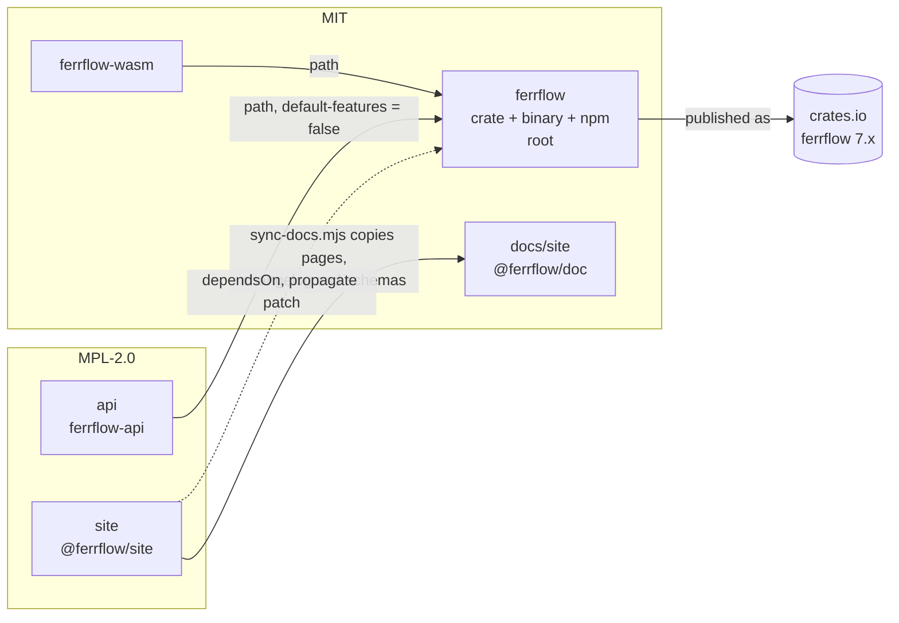
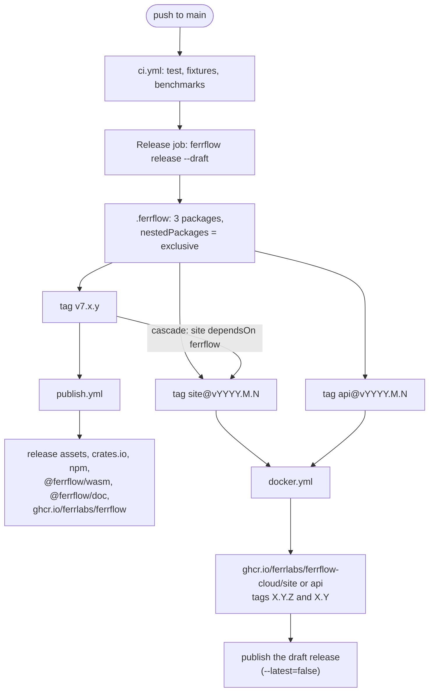

# Monorepo layout and release

Which package depends on which, and what happens to a tag. Describes `main`; see
[ARCHITECTURE.md](../../ARCHITECTURE.md) for the CI jobs.

## Packages and dependencies

The API takes the CLI as a path dependency on the root, so both always build from the same commit.

## From a commit to a published artefact

A push that only touches `docs/site/**` does not start `ci.yml`, so it cannot reach the Release job.
